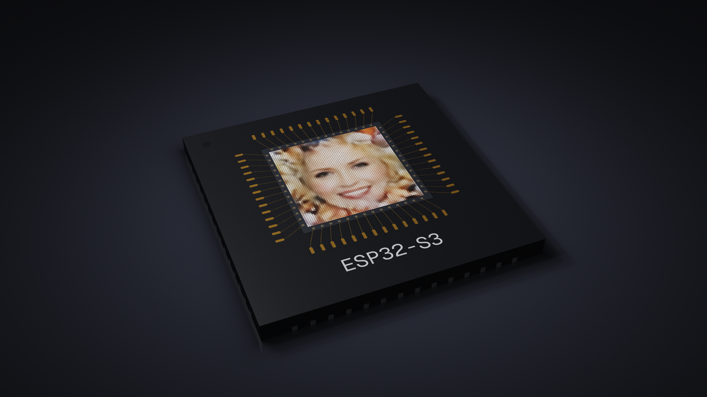
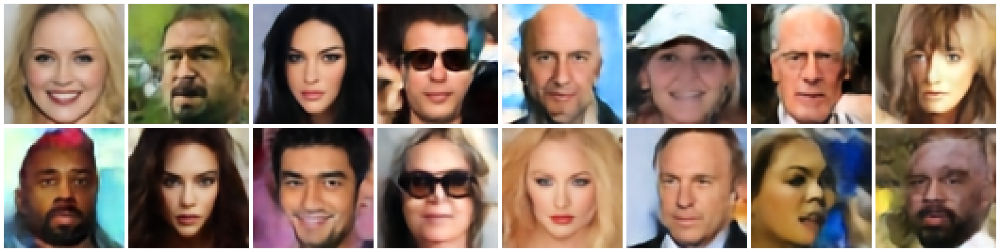

# ESP32-S3 Text-to-Image



Диффузионный трансформер (DiT), который рисует лицо 64×64 по русскому описанию **прямо на ESP32-S3**. Облако и компьютер для вычислений не нужны: компьютер только передаёт текст по USB и показывает картинку.

- 2,9 млн параметров, int8 (W8A8), веса 3,1 МБ во flash
- rectified flow, classifier-free guidance
- GEMM на векторных инструкциях PIE (`ee.vmulas.s8.accx`) на двух ядрах
- **5,4 с** на картинку за 8 шагов, **2,9 с** за 4 шага



## Что нужно

- Плата на **ESP32-S3** с **8 МБ flash** и **PSRAM** (quad SPI, от 2 МБ). Проверено на ESP32-S3 (QFN56) со встроенной PSRAM на 2 МБ.
- USB-кабель. Подключайте к порту **USB** (встроенный USB-Serial/JTAG), а не к порту UART.
- Python 3.9+.

> Если у вас модуль с **octal PSRAM** (например, ESP32-S3-WROOM-1 N16R8), готовые бинарники не подойдут. Пересоберите прошивку с `CONFIG_SPIRAM_MODE_OCT=y` (см. «Сборка из исходников»).

## Быстрый старт (без ESP-IDF)

**1. Установите зависимости**

```bash
pip install esptool -r host/requirements.txt
```

**2. Прошейте плату** (порт: `COM5` на Windows, `/dev/ttyACM0` на Linux, `/dev/cu.usbmodem101` на macOS)

```bash
esptool.py --chip esp32s3 -p PORT -b 921600 write_flash \
  0x0      bin/bootloader.bin \
  0x8000   bin/partition-table.bin \
  0x10000  bin/tti_esp.bin \
  0x200000 bin/model.bin
```

Прошивка с весами займёт около 40 секунд.

**3. Сгенерируйте картинку**

```bash
python host/tti.py "улыбающаяся девушка со светлыми волосами"
```

Порт определяется автоматически. Картинка рисуется прямо в терминале (нужна поддержка truecolor) и сохраняется в `out.png` в размере 256×256.

Полезные параметры:

```bash
python host/tti.py "пожилой мужчина с бородой в очках" --steps 4 --seed 7 --cfg 3 --out man.png
```

| Параметр | По умолчанию | Что делает |
|---|---|---|
| `--steps` | 8 | число шагов: 4 вдвое быстрее, разница почти незаметна |
| `--seed` | 1 | начальный шум: другой seed — другое лицо |
| `--cfg` | 3.0 | насколько строго следовать тексту (1 — почти игнорирует, 5 — пересвет) |
| `--port` | авто | порт платы, если автопоиск не сработал |
| `--reset` | — | перезагрузить плату перед генерацией |

## Что понимает модель

Словарь крошечный — 45 основ слов из атрибутов CelebA. Слова обрезаются до первых пяти букв, поэтому падежи и род не важны.

**Кто:** девушка, женщина, мужчина, парень, бабушка, дедушка, блондин(ка), брюнет(ка)
**Возраст:** молодой, пожилой
**Волосы:** светлыми, тёмными, каштановыми, седыми, волнистыми, прямыми, с чёлкой, лысый
**Лицо:** улыбающийся, серьёзный, бледный, полный, с бородой, с усами, с румянцем, с открытым ртом
**Аксессуары:** в очках / без очков, в шляпе, в галстуке, в серьгах, с помадой, с макияжем

Неизвестные слова (например, «рыжая») просто игнорируются.

Примеры:

```
молодой парень с тёмными волосами в очках
улыбающаяся брюнетка с помадой
дедушка с седыми волосами в галстуке
блондинка с макияжем
```

## Протокол (если хотите свой клиент)

Плата слушает USB-Serial/JTAG. Строка запроса:

```
GEN <seed> <steps> <cfg> <shift> <dual> <fast> <pie>|<промпт>\n
```

Например, `GEN 1 8 3.0 1.0 1 1 1|девушка в шляпе`. Флаги `dual`, `fast` и `pie` включают второе ядро, быстрые exp/GELU и SIMD-ядро. Если поставить их в 0, получится медленная «эталонная» версия, удобная для замеров.

В ответ приходят строки лога (`tokens: …`, `step i/n …`), профиль `PROF total=… dit=… dec=…` (в микросекундах) и `IMG <base64>` — 64×64×3 байт RGB.

## Сборка из исходников

Нужен [ESP-IDF](https://docs.espressif.com/projects/esp-idf/en/v5.3.2/esp32s3/get-started/) v5.3.

```bash
cd firmware
idf.py set-target esp32s3
idf.py build
idf.py -p PORT flash
esptool.py --chip esp32s3 -p PORT -b 921600 write_flash 0x200000 ../bin/model.bin
```

Веса лежат в отдельном разделе `model` (0x200000) и не стираются при перепрошивке приложения.

## Структура

```
bin/        готовые бинарники: загрузчик, таблица разделов, прошивка, веса модели
firmware/   исходники прошивки (ESP-IDF): engine.c — весь инференс, dot_s3.S — PIE-ядро
host/       клиент для ПК: отправляет промпт и показывает картинку
```

## Лицензия и данные

Веса модели обучены на датасете [CelebA](https://mmlab.ie.cuhk.edu.hk/projects/CelebA.html), поэтому подпадают под его условия: только некоммерческое исследовательское использование. Все картинки в репозитории сгенерированы моделью на ESP32-S3.
